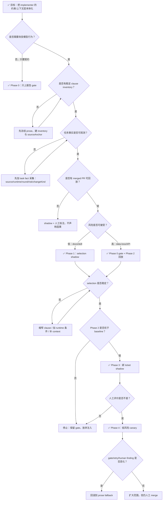

# 把 `autopilot-implementer` 改成「本体约束 + 条件注入」

> 研究提案 / grilling 自问自答 / 决策树与证据
> 目标技能：`autopilot-implementer`（父运行器：`autopilot-orchestrator`）
> 基线：实际跑过 autopilot 并已合入的 PR #127（Spec #121，tickets #122–#126），以及 #153、#154、#155
> 日期：2026-11-17
> 状态：设计 + 可复现的确定性实验 + T126 4 次 pilot；完整 30 次回放未执行

---

## 0. 结论先行

**推荐路径：不重写 `autopilot-implementer`，而是在它外面加三层确定性约束：**

1. **Clause Inventory（条款清单）**：把 implementer 的 37 条规范性义务（其中 I37 来自 orchestrator 的 spec 契约，其余来自 implementer prose）抽成可查询的 TTL，每条带 `sourceAnchor`、适用条件、默认检查项。
2. **Conditional Injection（条件注入）**：用任务事实（source / runtime / round / specLinked / multiModule / unverified / refactoring / suggestions / toolchain / changeKinds / risks）选择本次真正适用的 clause 和 context card，只注入命中的内容。
3. **Report Gate（报告门禁）**：模型仍然写代码、跑测试、生成 `IMPLEMENTER_REPORT`；SHACL 只检查报告契约是否成立，不检查代码是否“好”。退出码 0/1/2，2 一律 fail closed。

**prose 仍是权威源**。TTL 是从 prose 编译出来、带来源锚点和覆盖账本的索引层；第一阶段不做“TTL 反向生成 prose”。

**分阶段采用，不要一次全上：**

| 阶段 | 做什么 | 风险 | 本次是否完成 |
|---|---|---|---|
| Phase 0 | 只上报告契约 gate（不改变模型行为） | 低 | 确定性实验完成，未接入生产 |
| Phase 1 | clause 选择 + context 注入，shadow 模式 | 中 | 确定性选择实验完成 |
| Phase 2 | 在 #122–#126 上回放 prose vs ontology | 中高 | **pilot 已跑 4 次（T126×2 臂×2 次）；完整 30 次未跑** |
| Phase 3 | 新 ticket shadow，不自动 merge | 中 | 未执行 |
| Phase 4 | canary，人工 merge | 高 | 未执行 |

**一句话：本体负责“这次该守哪些约束、该看哪些上下文、报告必须长什么样”，模型负责“写代码和判断”，SHACL 负责“不认账就不过”。**

本次不声称“本体能提升代码质量”。这次能证明的是：**选择更准、注入更省、报告契约可被确定性检查**。代码质量是否提升，必须走 Phase 2 的真实回放。

---

## 1. 问题与基线

### 1.1 为什么是 implementer

用户要求“在有已合并 PR 做基线的技能中选一个”。候选对比：

| 技能 | 有真实 merged PR 任务/输出 | 输出是否可执行验证 | 是否有 runtime 漂移 | 形式化收益 | 爆炸半径 |
|---|---|---|---|---|---|
| **implementer** | 有：#127（#122–#126）、#153–#155 | **强**：合并后的测试就是 hidden tests | 有：canonical vs DSH 的 retry 范围不同 | 中高：护栏 + 上下文选择 + 报告契约 | 高：会改代码 |
| reviewer | 有任务，但 reviews/comments 均为 0 | 弱：没有历史审查判断可对照 | 有：4 vs 5 axes | 中：契约可测，判断不可测 | 低：只读 |
| orchestrator | 有 | 中：状态/标签可查，但无 durable 单 ticket 输出 | 有 | 中：状态机更适合代码 | 高：改状态 |
| director | 有，但 #136 dogfood 未完成 | 中 | 少 | 低：状态转移已由 CLI 拥有 | 高：驱动多 ticket |
| distill | 输出 issue，不是 PR | 弱 | 有 | 低 | 中 |

**选 implementer 的核心理由：它的合并结果留下了可执行的基线。**

- #127 合并后 `cargo test --workspace` 334 passed；`scripts/check.rs` ALL PASS；`validation/run.rs` 53 skills PASS；clippy / rustfmt clean。PR body 另记录一个既有的 NOT_RUN：`test_distill_release_gate` 因过期 evidence sha 未跑，不是本 PR 引起。
- PR #127 的 GitHub reviews/comments 都是 0；body 里写了 two-axis review，但没有逐条 reviewer 输出可作历史基线。因此这里能用的是测试基线，不是审查判断基线。
- 每个 child ticket 有独立 commit：#122 `054dacb`、#123 `93bde83`、#124 `ac573e4`、#125 `98270ef`、#126 `e3818a8`，review fixes `310f982`。
- 因此可以回到每个 ticket 的父 commit，用“合并后的测试”作为 hidden tests 回放，而不是靠人给 reviewer 打分。

**没有“已合并的技能转换 PR”可作为基线。** 这是必须说清楚的限制：

- `gh search prs 'ontology skill SHACL' --merged`、`'conditional context skill ontology' --merged` 无相关结果。
- `MatthewYe/dsh-superagent-prototype` PR #29 是 CLOSED/unmerged 的 completion-gate MVP，不是技能转换。
- `open-ontologies` merged PR #397–#408 是 server/tool bug。
- 本地 `ontology-driven-agents` 无远端仓库。
- #127、#153–#155 是**任务基线**，不是“本体化实现”的基线。

所以本提案的定位是：**用真实 autopilot 任务做任务基线，用确定性实验验证选择层和契约层，真实代码质量提升留给 Phase 2 回放。**

### 1.2 implementer 的现状

canonical 文件：`skills/autopilot/autopilot-implementer/SKILL.md`，169 行。
runtime 变体：`dsh/SKILL.md` 183 行、`kimi/SKILL.md` 176 行、`reasonix/SKILL.md` 191 行、`codex/agent.toml`。

输入：

- 本地 `.scratch/<issue_dir>/AGENT-BRIEF.md` + `issue.md`；
- 或 GitHub issue（`IS_GITHUB: true`，契约在 issue body，`gh issue view <N> --json body`）。

条件性 dispatch 变量：

- `CROSS_ISSUE_SUGGESTIONS`：JSON 数组，含 source_issue / round / content / files / keywords / reviewer_context；
- `Seam:`（人工）或 `Seam(inferred):`（orchestrator 推断）；
- `ROUND:` + `PREV_REVIEW:` 重试；
- `REFACTORING: true`；
- `TOOLCHAIN: available | unavailable`。

输出：以 `IMPLEMENTER_REPORT:` 开头，包含 `ROUND`、`STATUS: DONE|UNVERIFIED|BLOCKED|NEEDS_CONTEXT`、`SUGGESTION_RESOLUTIONS`、`SELF_REVIEW`、`CHANGED_FILES`、`SUMMARY`。

### 1.3 真实漂移：不是假想问题

canonical 与 DSH 变体在 retry 模式上语义不同：

| 位置 | 文本 | 含义 |
|---|---|---|
| `skills/autopilot/autopilot-implementer/SKILL.md` retry | “Only fix the Critical issues listed in `PREV_REVIEW`” | 旧表述：只修 Critical；与 ADR 0039 §4 冲突 |
| `skills/autopilot/autopilot-implementer/dsh/SKILL.md` retry | “修复 `PREV_REVIEW` 中列出的**全部 Critical 和 Important** 问题” | Critical + Important 都修 |

这不是可接受的条件差异：规范文本是 ADR 0039 §4，`Critical` 和 `Important` 都强制 RETRY、都必须修；canonical 的 “Only fix Critical” 属于旧 prose drift。实验按 ADR 编码，并把旧措辞记录为 drift，而不是让 gate 接受 `CriticalOnly`。它正好说明：条件注入不是“把 prose 抄进 TTL”，而是把“在什么 runtime / 什么 round 下哪条义务生效”变成可查询、可校验的数据；发现 prose 与规范冲突时，不能把冲突固化成合法分支。

DSH 还多了：

- 先读 `~/.agents/principles/karpathy.md`；
- 显式加载 `~/.agents/skills/tdd/SKILL.md`、`mocking.md`、`diagnosing-bugs/SKILL.md`；
- DSH sandbox / plan-mode 说明；
- `todo_write` 清单。

canonical 没有这些。任何“一份 prose 走所有 runtime”的方案都会继续漂移。

### 1.4 不在本次范围

- 不修改上游 `autopilot-toolkit` 仓库；
- 不实现生产版 implementer；
- 不把“怎么写出好测试 / 怎么诊断 bug / 怎么做架构取舍”形式化；
- 不替换 `autopilot-orchestrator` 的 dispatch、label、retry 状态机；
- 不声称本体能替代 TDD 的创造性循环；
- 不做完整 30 次真实模型回放；只做 T126 的 4 次 pilot（通过 DSH subagent 执行，未使用 `DEEPSEEK_API_KEY`；完整回放成本未获授权）。

---

## 2. 目标与父 skill 的关系

用户问过：“implementer 还从属于一个父 skill 吧，这两者怎么选？”

答案：**不是二选一，是分层。**

- `autopilot-orchestrator` 是**运行父 skill**：扫描 issue、打 label、dispatch implementer/reviewer、处理 retry、做 meta-review。
- `autopilot-implementer` 是**转换单元**：一次 ticket 的输入是 issue/AC，输出是代码 + 测试 + `IMPLEMENTER_REPORT`。
- `autopilot-director` 是另一条 spec 路径的父级，不适合本实验：它的状态转移已经由 director CLI 拥有，#136 的真实端到端 dogfood 仍未完成。

| 维度 | orchestrator | implementer |
|---|---|---|
| 职责 | 调度、状态、重试、meta-review | 单 ticket 实现 |
| durable 产物 | label / dispatch / 日志，弱 | 代码、测试、报告，强 |
| merged PR 能证明什么 | 流程跑过 | 具体 AC 被实现、测试通过 |
| 形式化适配度 | 状态机更适合代码，不适合本体 | 输入事实 + 义务 + 报告契约，适合本体 |
| 爆炸半径 | 大：改状态/标签 | 中：改代码，但有测试和 gate |

**结论：转换 implementer；orchestrator 作为验证时的运行外壳。** 真实回放仍然通过 orchestrator 跑，才能覆盖 retry / `PREV_REVIEW` / `CROSS_ISSUE_SUGGESTIONS` 这些条件分支。

---

## 3. 形式化什么，不形式化什么

### 3.1 形式化对象

本次把 implementer 的约束分成 37 条 `Clause`（I37 来自 orchestrator 的 spec 契约），聚成 10 个 `Rule`：

| Rule | 条款 | 说明 |
|---|---|---|
| R1 TDD gate | I01–I05 | 失败测试先行、行为断言、mock 边界、RED/GREEN/REFACTOR、AC 覆盖 |
| R2 Context gate | I06–I10 | 读 issue/brief、GLOSSARY、spec/ADR、Seam、suggestions |
| R3 Retry gate | I11–I14 | retry 必须修 Critical+Important（ADR 0039）；旧 canonical SKILL.md 的 “只修 Critical” 是 drift；不重做已过 AC；不加新功能 |
| R4 Refactoring gate | I15 | 行为保持、跳过新代码 RED、前后跑既有测试 |
| R5 Diagnosis gate | I16、I25、I26、I28 | 最多两个假设；BLOCKED/NEEDS_CONTEXT 必须点名事实；不猜 |
| R6 Self-review gate | I17–I20 | 全量测试、AC 覆盖、scope creep、CHANGED_FILES 完整 |
| R7 Report gate | I21–I24 | 报告 schema、DONE 证据、toolchain 降级、UNVERIFIED 标注 |
| R8 Risk gate | I29–I34 | type-check、sibling modules、data-loss 回滚测试、API 契约、行为保持、依赖 |
| R9 Runtime gate | I35–I36 | DSH sandbox、crates 改动后刷新 cache |
| R10 Spec gate | I08、I37 | spec/ADR 阅读、AC 到 spec 的映射、deliberate changes |

每条 clause 带：

- `clauseId`、`axis`、`text`、`sourceAnchor`；
- `defaultCheck`（报告里必须出现的检查项）；
- 适用条件：`whenSource`、`whenRuntime`、`whenRound`、`whenSpecLinked`、`whenMultiModule`、`whenUnverified`、`whenRefactoring`、`whenSuggestions`、`whenToolchain`、`whenChangeKind`、`whenRisk`。

### 3.2 不形式化对象

| 不形式化 | 原因 |
|---|---|
| 怎么写出好测试 | 这是判断力，不是条款选择；形式化会退化成“用 TTL 重写 TDD 教材” |
| 怎么诊断 bug | 需要探索和假设，不能预先枚举 |
| 代码品味 / 架构取舍 | 没有稳定 ground truth，SHACL 也检查不了 |
| 具体实现步骤 | implementer 的创造性核心；本体只设边界 |
| PR merge 决定 | 人类/ reviewer 的权限，不能由 gate 代替 |

### 3.3 为什么用本体，而不是 YAML / JSON Schema

这是 grilling 里必须回答的问题。答案不是“本体更高级”，而是：

1. **条件是多维的、可组合的**：`runtime=dsh AND round=retry`、`risk=data-loss AND changeKind=rust-crate`。YAML 也能表达，但条件组合、规则 provenance、覆盖查询会迅速变成手写分支。
2. **需要 provenance**：每条 clause 能追到 `sourceAnchor`；每条 rule 能追到 clause；报告里的每个 finding 能追到 clause。SHACL + SPARQL 直接支持这些查询。
3. **需要同时做选择和校验**：同一份 TTL 既被 selector 查询，又被 report gate 校验。YAML 需要两套解析器。
4. **需要可扩展的 runtime 维度**：canonical / dsh / kimi / reasonix 的差异可以做成数据，而不是复制 prose。

但本体不是没有代价：TTL 的编写/维护成本高于 YAML；团队需要会 SPARQL/SHACL 的人。**所以推荐“prose 权威、TTL 派生”，并在 CI 里做 clause 覆盖校验，避免 TTL 成为第二真相源。**

---

## 4. 架构

### 4.1 四层

```
prose SKILL.md / variants
        │  (authoring, source anchors, coverage ledger)
        ▼
Clause Inventory (TTL)  ──►  Task Facts (TTL)
        │                         │
        └────────► Selector (SPARQL) ◄──────────┘
                         │
                         ▼
              Injection Plan (clauses + context pointers)
                         │
                         ▼
                 Model (implementer)
                         │
                         ▼
              IMPLEMENTER_REPORT + code/tests
                         │
                         ▼
                  SHACL Report Gate
                    │            │
                 exit 0       exit 1/2
                 accept       reject / fail closed
```

### 4.2 关键设计选择

1. **Selector 是确定性的**：不让模型“自己决定该守哪些条款”。模型只看到注入后的 plan。
2. **Context 只给指针 + 短摘录**：默认 hybrid；完整上下文由模型按需读取，避免一次性塞 20K 字符。
3. **Report gate 只检查契约**：schema、覆盖、severity、verdict、证据、retry 范围、spec 映射；不检查代码是否正确。
4. **Fail closed**：SHACL 退出码 2（无法编译/无法判定）一律拒绝，不把“未知”当“通过”。
5. **Provenance 可追溯**：clause → sourceAnchor；rule → clause；report finding → clause；gate violation → shape。

### 4.3 与 `completion-gate` / `conditional-context` 的关系

- 复用 `completion-gate` 的 SHACL gate 语义：standalone `shacl` 退出码 0/1/2；`batch` 在 `conforms:false` 时仍退出 0，不能用来做 gate；OWL reason 在不一致时也退出 0，不能当 gate。
- 复用 `conditional-context` 的“选择 ablation”方法：none / generic / keyword / ontology 四臂。
- 复用 `ontology-agent-lab` 的原则：固定 SPARQL 模板、neutral clause inventory、derived fact 带 provenance、脚本不直接命名 clause。

---

## 5. 条件注入设计

### 5.1 任务事实

5 个真实 ticket：

| Task | Issue | 改动类型 | 风险 | spec-linked | multi-module | runtime |
|---|---|---|---|---|---|---|
| T122 | #122 expand | rust-crate | api-contract, behavior-preservation | true | false | canonical |
| T123 | #123 validation | rust-crate | api-contract, behavior-preservation | true | true | canonical |
| T124 | #124 deploy | rust-crate | data-loss, behavior-preservation | true | true | canonical |
| T125 | #125 toolkit-setup | skill, test | behavior-preservation | true | true | canonical |
| T126 | #126 contract | rust-crate | api-contract, behavior-preservation | true | true | canonical |

这些事实来自 issue body + PR diff + ADR，不是模型猜的。生产中应由 orchestrator 在 dispatch 时采集，写进 task context。

### 5.2 条件语义

- 同一条件族内 OR；不同条件族之间 AND。
- `whenRuntime` 做规范化：`RuntimeDSH` → `dsh`，`RuntimeCanonical` → `canonical`。
- `whenRound`：`first` / `retry`；retry 才触发 I11–I14。
- `whenRisk` / `whenChangeKind` 是多值；任一命中即该条件族成立。
- `scope RepoGovernance` 的 clause（如跨 runtime parity）不进入单 ticket plan。

### 5.3 25 个 context card

- 每个 task 的 issue card；
- Spec #121、ADR 0045、base `CONTEXT.md` 的 “Skill file”；
- skill-index 接口与枚举测试；
- validation-runner targets 与测试；
- deploy dev/pack 与测试；
- toolkit-setup 与测试；
- workspace test list。

excerpt 全部从 T126 base commit `98270ef` 读取（`git show`），不读当前 worktree，因此不会带入 merged PR 的 diff 或测试。

每张 card 带 `sourcePath`、`sourceStart`、`sourceEnd`、`excerpt`、`charCount`、适用条件。注入时只给路径 + 行号 + 短摘录；模型需要时再打开。

### 5.4 注入模式

| 模式 | 内容 | 平均字符（5 task） |
|---|---|---|
| full | 所有 clause 全文 + 所有 context 全文 | 26361（generic） |
| ids | 只给 clause/context ID | 218（ontology） |
| compact | clause ID + context 标题 | 242（ontology） |
| hybrid | clause 全文 + context 路径/行号指针 | **1,735（ontology 估算）** |

推荐 hybrid：条款全文是规范，必须给；上下文只给指针，避免把 20K 字符一次性塞进 prompt。

> 口径说明：上表的 hybrid 字符数只算“条款全文 + context 路径/行号指针”，不含 context 摘录。`scripts/render_plan.py` 为了让审阅者看到实际形态，额外附了 180 字符摘录，因此生成的 `results/plan-T*.md` 为 5.4K–7.0K 字符；真正注入时可以不带摘录，或让模型按需打开。两个数不要混用。

---

## 6. 报告门禁

### 6.1 10 个 SHACL shape

| Shape | 检查 |
|---|---|
| `ReportSchemaShape` | 恰好一个 task/plan/status/round/toolchain；status 枚举；至少一个 AC、一个 changed file |
| `ClauseCoverageShape` | plan 注入的每条 clause 都有 check |
| `DoneEvidenceShape` | DONE 时所有 AC 都是 pass，且没有 `not-run` |
| `ToolchainShape` | toolchain=false 时不能 DONE |
| `UnverifiedMethodShape` | UNVERIFIED 时每个 AC 都有 verificationMethod |
| `BlockedShape` | BLOCKED 时 hypotheses ≥ 2 |
| `NeedsContextShape` | NEEDS_CONTEXT 时 missingContext 非空 |
| `TddEvidenceShape` | 每个 production changed file 都有 `hasTestEvidence true` |
| `RetryScopeShape` | retry 必须是 CriticalAndImportant；CriticalOnly 是反例 |
| `SpecMappingShape` | specLinked 时 specMapping 非空 |

### 6.2 为什么 gate 不检查代码

- 代码质量没有可判定的 ground truth；SHACL 检查“代码是否好”会变成主观规则。
- 代码正确性由测试、CI、reviewer 负责；gate 只保证“报告没有撒谎”。
- 但 gate 可以检查“声明与证据一致”：DONE 必须有执行过的 pass；UNVERIFIED 必须标注方法；BLOCKED 必须有两个假设。

### 6.3 实验结果

`results/gate.txt`：

- 15 个 fixture：1 valid + 14 invalid。
- 15/15 符合预期；valid 退出 0；14 个 invalid 全部退出 1；0 个 false reject。
- 覆盖：缺 check、非法 status、DONE 带 not-run、UNVERIFIED 无方法、BLOCKED 只有 1 个假设、changed files 空、production 无 TDD 证据、retry scope 错误、toolchain=false 却 DONE、spec-linked 无 specMapping、NEEDS_CONTEXT 无 missing fact。

**这证明 gate 能拒绝“报告层面的伪完成”，不证明代码正确。**

---

## 7. 确定性实验

### 7.1 语料

`experiment-ontology-implementer/corpus/`：

- `issue-121.json`（spec，13K）
- `issue-122.json` … `issue-126.json`（2.1K / 2.0K / 1.6K / 1.6K / 1.5K）
- `pr-127.diff`（96K）

所有 issue 都有 `## What to build` + `## Acceptance criteria`；#122 无 blocker，#123/#124/#125 blocked by #122，#126 blocked by #123/#124/#125。

### 7.2 实验臂

| 臂 | 做法 |
|---|---|
| none | 不注入任何 clause/context |
| generic | 注入全部 37 clause + 25 context |
| keyword | 按关键词命中（每个 clause 有 keyword 列表） |
| ontology | 按 TTL 条件 + SPARQL 选择 |

### 7.3 选择结果

| 臂 | clause recall | clause precision | context recall | context precision | exact runs | hybrid 估算 | 实际 rendered |
|---|---|---|---|---|---|---|---|
| none | 0.00 | 0.00 | 0.00 | 0.00 | 0/5 | 0 | 540 |
| generic | 1.00 | 0.676 | 1.00 | 0.296 | 0/5 | 3,195 | 12,016 |
| keyword | 0.368 | 0.940 | 0.144 | 1.00 | 0/5 | 650 | 2,141 |
| **ontology** | **1.00** | **0.984** | **1.00** | **1.00** | **3/5** | **1,735** | **5,807** |

逐 ticket：

- T122：ontology 24/25 clause（多选 I33），5/5 context，exact=False，hybrid 估算 1,620，rendered 5,143。
- T123：26/26，7/7，exact=True，hybrid 1,757，rendered 5,813。
- T124：25/26（多选 I31），7/7，exact=False，hybrid 1,743，rendered 5,780。
- T125：24/24，7/7，exact=True，hybrid 1,649，rendered 5,533。
- T126：26/26，11/11，exact=True，hybrid 1,905，rendered 6,767。

**解释：**

- ontology 的 clause recall 100%，precision 98.4%；两次多选分别是 T122 的 I33（行为保持）和 T124 的 I31（回滚测试），都是“条件命中但人工 gold 认为不必要”的边界情况。
- context 选择 37/37，precision/recall 100%。
- generic 虽然 recall 100%，但 precision 0.676/0.296，注入 26K 字符，模型需要自己过滤。
- keyword 精度高但 recall 只有 36.8%/16.4%，漏掉大量必须条款。
- 实际 rendered payload 五票均值 5,807 字符，比 generic 的 12,016 少 51.7%；hybrid 估算 1,735 vs 3,195，少 45.7%；同 generic 全量文本均值（8,753 vs 26,361）少 66.8%，同时保持 100% clause recall。

### 7.4 这个实验证明了什么

**能证明：**

- 条件模型可以从真实 ticket 事实中选出适用的 clause 和 context，且精度/召回显著优于 generic/keyword。
- 同一份 TTL 可以同时驱动选择与报告 gate。
- runtime 漂移（canonical vs DSH retry 范围）可以被编码成条件，而不是复制 prose。

**不能证明：**

- 模型看到注入后会遵守（selection ≠ compliance）。
- 代码质量、测试质量、AC 完成度会提升。
- 本体比 prose 更能让模型“理解”任务。
- gate 能发现代码中的真实 bug。

### 7.5 效度威胁

| 威胁 | 说明 | 缓解 |
|---|---|---|
| 小样本 | 5 个 ticket，同一 spec、同一作者 | 用 #153–#155 作第二组；Phase 2 扩大 |
| gold 与条件同源 | clause gold 由同一套条件匹配生成，再做两处人工删减（T122 去 I33、T124 去 I31），存在循环 | 在 Phase 2 用 hidden tests 作为外部标准；context gold 由 PR diff/ADR 独立标注 |
| 合成 fixture | gate 用 13 个构造报告 | Phase A 用真实 PR body/commit 重建报告 |
| 无模型回放 | 本报告主体没有 LLM 输出 | 已有 T126 pilot 4 次；完整 30 次仍未跑，不能据此声称质量提升 |
| 无生产接入 | 未改 autopilot-toolkit | 先 shadow，再 canary |
| 无 merged 转换基线 | 找不到同类 PR | 明确区分“任务基线”与“转换基线” |

---

## 8. 用真实 autopilot 需求验证

这是本提案最重要的部分：**怎么证明它不是纸上谈兵。**

### Phase A：报告契约回放（离线，低成本）

目的：验证 gate 对真实报告的判定，而不是只对合成 fixture。

步骤：

1. 取 #127、#153、#154、#155 的 PR body、commit message、changed files。
2. 按 `IMPLEMENTER_REPORT` 契约重建 4 份报告：ROUND、STATUS、AC 结果、CHANGED_FILES、verification evidence、spec mapping。
3. 对每份报告跑 gate，记录 exit code。
4. 做 10 种“报告造假”变异：把 UNVERIFIED 改成 DONE、删掉一个 AC 的测试证据、把 BLOCKED 的 hypotheses 改成 1、把 canonical retry 范围改成 CriticalAndImportant、删掉 spec mapping、把 production file 标成 test、重复 changed file、 status 拼错、toolchain=false 却 DONE、空 missingContext。
5. 指标：gate 对真实报告的 pass 率；对 10 种变异的拒绝率；false reject 数。

**通过标准：** 真实报告 4/4 通过；变异拒绝 ≥ 9/10；false reject = 0。若真实报告本身不满足契约，先修报告生成，而不是放宽 gate。

### Phase B：真实 implementer 回放（核心）

目的：回答“ontology 约束是否让 implementer 更好地完成真实 AC”。

设置：

- 基线：当前 prose implementer（canonical 或 DSH，按 runtime 固定）。
- 处理：同一模型 + 同一 prompt 骨架 + ontology 注入的 clause/context plan。
- 模型：deepseek-flash（或团队指定的实现模型），temperature=0，N=3。
- 每个 ticket 用独立 git worktree，base 是该 ticket 的父 commit：

| Ticket | 合并 commit | 回放 base |
|---|---|---|
| #122 | `054dacb` | `5653b94` |
| #123 | `93bde83` | `054dacb` |
| #124 | `ac573e4` | `93bde83` |
| #125 | `98270ef` | `ac573e4` |
| #126 | `e3818a8` | `98270ef` |

- 隐藏测试：从合并后的 commit 取该 ticket 对应的测试文件/测试名；agent 不可见。跑：
  - ticket 相关测试；
  - 全量 `cargo test --workspace`（回归）；
  - `scripts/check.rs`、`validation/run.rs`（仓库门禁）。
- 不允许 agent 看到合并 diff、PR body、hidden tests。
- 记录：模型、prompt、注入 plan、token 数、耗时、成本。

指标（主/次）：

| 类型 | 指标 | 说明 |
|---|---|---|
| 主 | hidden test pass rate | 合并测试是否通过 |
| 主 | AC coverage | 每个 AC 是否有对应测试且通过 |
| 主 | report gate pass | 报告契约是否通过 |
| 次 | scope creep | 改了 AC 之外的文件/行为 |
| 次 | diff similarity | 与合并 diff 的结构相似度，仅参考 |
| 次 | prompt chars / tokens | 注入成本 |
| 次 | 人工盲评 | 代码可读性/可维护性，1–5 |

决策规则（预先注册，避免事后挑指标）：

- 处理组 hidden test pass 比基线高 **≥ 10 个百分点**，或
- 在 hidden test pass 不下降的前提下，report gate failure 减少 **≥ 50%**；
- 且 scope creep 不增加。
- 否则停止，只保留 Phase 0 gate。

**为什么是 10pp：** 5 个 ticket × 3 次 = 15 个配对样本，10pp 约等于 1.5 个 ticket 的差异；小于这个数的提升无法区分模型噪声和真实效果。

### Phase C：新 ticket shadow（不做 merge 决定）

- 选 2–3 个新的 `ready-for-agent` ticket。
- 同时跑 prose 与 ontology 两臂，产出两套 patch + 报告。
- 不自动 merge；由人看差异，记录：
  - 注入 plan 是否选对；
  - 模型是否遵守注入；
  - gate 是否误拒/漏拒；
  - 人工更愿意 merge 哪一版，为什么。
- 通过标准：至少 2/3 的 ticket 中，ontology 臂的 gate pass 且人工评价不差于 prose；若模型忽略注入，记录具体 clause。

### Phase D：canary（小流量）

- 只对低风险 ticket（docs、skill、非 data-loss）启用 ontology 注入。
- 保留 prose fallback；gate 失败自动回退。
- 监控：gate failure rate、retry rate、human review findings、rollback 次数。
- 任何 data-loss / API-contract 变更先不启用。

### 回放的成本与停止条件

- 5 ticket × 2 臂 × 3 次 = 30 次实现运行；按 deepseek-flash 价格和平均 token 估算，成本可控。
- 如果 30 次内没有达到主指标，停止，不扩大样本“碰运气”。
- 如果 gate 在 Phase A 就有高 false reject，先修 gate，不进入 Phase B。

### Phase 2 pilot 实际结果（2026-11-18，T126）

pilot 用真实 ticket T126（退役 `ExpectedSetEntry.resolution`，base `98270ef`，merged `e3818a8`），
sanitized worktree，`deepseek-flash`，2 臂 × 2 次。计划中的 context 指针（包括父规格
`corpus/issue-121.json`）在 prep 时物化并校验可读。隐藏检查是 merged 测试套件 + 结构性检查
（entry 上不得再有 `pub resolution`）；报告检查是结构性的，未接 SHACL gate。温度用 DSH 默认值，
不是 0；因此这是 harness 验证，不是 30 次 go/no-go。

| run | arm | `cargo test --workspace` | serial rerun | structural | report | status |
|---|---|---|---|---|---|---|
| prose-1 | prose | 0 | — (parallel) | pass | pass | DONE |
| prose-2 | prose | 0 | — (parallel) | pass | pass | DONE |
| ontology-1 | ontology | 0 | 0 | pass | pass | DONE |
| ontology-2 | ontology | 0 | 0 | pass | pass | DONE |

四次的 `toolkit_setup`、`skill_check`、`validation/run.rs`、`clippy -D warnings` 都是 0。
prose 两跑使用默认并行配置；ontology 两跑因更早的 ontology-1 并行尝试撞到
`shared::tests::load_skill_lock_from_temp_project` 的 `PROJECT_ROOT` 环境变量竞态（exit 101），
串行 overlay 通过。不是实现差异。

结论：

- 4/4 通过隐藏测试和结构检查，**两臂没有可观测差异**；pilot 没有显示 ontology 注入带来代码质量收益。
- 也没有 gate failure 差异（4/4 report contract pass），所以按预注册规则不能宣称 Phase 2 成功。
- 这符合“selection ≠ compliance”：plan 选得准，但在这个边界清楚的 ticket 上，prose 模型本来就能做对。
- 下一步若要继续：优先选更 ambiguous 的 T123/T125，温度 0、每臂 3 次、盲评；否则保留 Phase 0 gate，
  不把 ontology 注入设为默认。完整 30 次没有跑，本报告不声称它通过或失败。
- 限制：N=2、温度默认、只跑 T126；`tests/test_build.rs` / `tests/test_install.rs` 未完成
  （prose-1 的 `test_build` 跑到 65.2s 时被 SIGTERM，exit 101 是超时信号而非断言失败；
  后续手动尝试卡在 `deploy.rs dev` 的 cargo build 上），不计入 pass。

#### 过程 token

从 DSH 子会话的 `assistant/message.data.usage` 汇总，`totalTokens` 含 cache read，
是“处理过的 token”，不是账单金额；非缓存量 = input + output。

| run | model calls | input | output | cache read | total | non-cached |
|---|---:|---:|---:|---:|---:|---:|
| prose-1 | 65 | 117,380 | 30,789 | 3,230,848 | 3,379,017 | 148,169 |
| prose-2 | 51 | 93,324 | 20,775 | 2,718,848 | 2,832,947 | 114,099 |
| ontology-1 | 92 | 99,172 | 38,122 | 4,159,744 | 4,297,038 | 137,294 |
| ontology-2 | 75 | 221,614 | 44,485 | 3,796,224 | 4,062,323 | 266,099 |
| prose avg | 58 | 105,352 | 25,782 | 2,974,848 | 3,105,982 | 131,134 |
| ontology avg | 84 | 160,393 | 41,304 | 3,977,984 | 4,179,681 | 201,696 |

ontology 臂平均 total 高 34.6%（4.18M vs 3.11M），非缓存也高 53.8%
（201,696 vs 131,134），output 高 60.2%（41,304 vs 25,782）；N=2 且 total 区间不重叠（prose 最大 3.38M < ontology 最小 4.06M）。6,767 字符的 plan 只读一次
（约 1.8k–2.0k tokens），但两臂工具步数不同（ontology 84 次 vs prose 58 次），
不能把差异归因于注入本身。因此不能声称“本体注入更省 token”。原始数字在
`results/phase2/tokens.json`。

---

## 9. 决策树

### 9.1 拓扑



渲染版（SVG，gist）：

### 9.2 路径表

| 分支 | 选择 | 依据 | 结果 |
|---|---|---|---|
| 目标技能 | implementer | #127 有代码+测试基线；reviewer 无输出基线 | 采用 |
| 父运行器 | orchestrator | 状态机已有；implementer 是单 ticket 单元 | 采用 |
| 是否改模型行为 | 先不改 | 报告契约可独立验证，风险最低 | Phase 0 |
| 是否形式化 TDD | 否 | 创造性循环，无可判定 ground truth | 只用护栏 |
| 选择方式 | 本体条件 | 5 维条件组合，generic/keyword 效果差 | 采用 |
| 注入方式 | rendered | 5,807 vs 12,016 字符，clause recall 100% | 采用 |
| gate 语义 | SHACL + fail closed | 退出码 0/1/2；2 不当通过 | 采用 |
| 验证 | 真实回放 + hidden tests | 唯一能证明代码质量提升的方法 | Phase 2 必做 |
| 生产接入 | shadow → canary | 先证明不恶化，再扩大 | 未执行 |

---

## 10. Grilling 自问自答

### Q1. 这不就是把 prose 抄进 TTL 吗？

不是。TTL 只保留**可判定的义务 + 适用条件 + 来源锚点**，不保留解释性文字和例子。37 条 clause 是从 169 行 prose 压缩出来的；每条都能追到原文。真正的价值在“条件”和“可查询”，不在“把文字换个格式”。

### Q2. 为什么不直接用 JSON Schema 检查报告？

JSON Schema 能检查结构，不能检查语义关系：每条注入 clause 是否有 check、DONE 的 AC 是否都 pass、retry 范围是否匹配 runtime、spec mapping 是否存在。SHACL 可以表达这些关系，并且和 TTL 共用一套数据模型。

### Q3. 为什么不用 Rust 代码实现选择？

可以用代码。但条件会随 runtime、risk、round 增长，代码会变成大量 `if`；而且选择逻辑和 gate 逻辑会分叉。TTL + SPARQL 让条件成为数据，gate 和 selector 共享同一份模型。代价是团队要维护 SPARQL 查询和 TTL。

### Q4. 37 条 clause 是不是太多了？

37 条对应 169 行 prose 中的规范性句子，平均 4.5 行一条。不是每条都每次注入：5 个 task 实际选中 24–26 条。真正需要维护的是**条件**，不是数量。若 clause 继续增长，应按 Rule 分组，并给每条 clause 一个 owner 和测试。

### Q5. gold 是不是循环论证？

部分是。clause gold 由同一套条件匹配生成，再做两处人工删减，所以 clause recall 接近 100% 有定义成分。**Context gold 是独立的**：由 PR diff、ADR、issue body 手工标注，不是从条件生成。Phase 2 的 hidden tests 是外部标准，能打破循环。本报告明确标注这个限制，不把 100% 当成“模型有效”的证据。

### Q6. 选择 100% 有什么用？模型又不一定遵守。

选择 100% 只证明“该给的给了”，不证明“给了就会做”。这正是为什么 Phase 2 必须做。现有原型（conditional-context）已经显示 selection 与 compliance 分离：ontology 选择最好，但 E4 执行收益不支持。**所以本提案不承诺代码质量提升，只承诺选择/契约层的可验证改进。**

### Q7. 模型忽略注入怎么办？

三层处理：

1. 报告 gate 检查“报告是否覆盖了注入 clause”；忽略会体现为缺 check。
2. Phase 2 记录“注入但未遵守”的 clause，按 clause 统计，而不是只看总分。
3. 如果某类 clause 长期被忽略，先判断是注入方式问题（太长/太抽象）还是模型能力问题；不要用更多本体去补。

### Q8. 报告 gate 会不会被模型伪造？

会。gate 只能检查“报告内部一致”，不能证明测试真的跑过。缓解：

- 报告必须带可复现命令和输出摘要；
- CI 重跑关键测试（reexec trust mode）；
- gate 检查 `not-run` 不能出现在 DONE；
- 高风险 ticket 由 reviewer/人类复核。

这和 `completion-gate` 的 trust mode 结论一致：structural < integrity < reexec；gate 的强度取决于证据采集，不是 SHACL 本身。

### Q9. 为什么 gate 不检查代码？

代码正确性需要执行测试、静态分析、人的判断；SHACL 不适合。gate 检查“报告是否诚实”，测试/CI 检查“代码是否工作”，reviewer 检查“代码是否可维护”。三层分工，不要混。

### Q10. 没有 merged 转换基线，凭什么说这套方案有效？

不能说“这套方案已经被生产验证”。只能说：

- 任务基线真实（#127、#153–#155）；
- 选择/gate 在确定性实验中有效；
- 代码质量提升需要 Phase 2。

这是诚实的边界。把“任务基线”冒充“转换基线”才是问题。

### Q11. 为什么选 #122–#126，而不是更大的 PR？

因为 #127 是一个 spec 的 5 个 child ticket，每个有独立 commit、独立 AC、独立测试，适合做 per-ticket 回放；#153–#155 是第二组，覆盖 data-loss/API/CI 不同风险。更大的 PR 混杂多个关注点，难以归因。

### Q12. 回放时怎么处理 ticket 之间的依赖？

每个 ticket 用父 commit 建 worktree：#122 从 `5653b94`，#123 从 `054dacb`，#124 从 `93bde83`，#125 从 `ac573e4`，#126 从 `98270ef`。只回放该 ticket 的增量，不要求模型重做前序 ticket。hidden tests 用合并后的测试文件；如果测试依赖前序接口，base 已包含前序代码，所以可运行。

### Q13. 模型输出随机，怎么比较？

temperature=0 降低方差；每个 ticket N=3，配对比较同一 ticket 的两臂；报告均值、配对差、失败案例。不要用单次运行下结论。若方差仍大，增加到 N=5，但预先注册，不事后加样本。

### Q14. 怎么防止 ontology 和 prose 漂移？

- prose 是权威源；TTL 每条 clause 带 `sourceAnchor`（文件 + 行号/段落）。
- CI 做 coverage check：prose 中每条规范性句子必须映射到 clause，反之亦然。
- 修改 prose 必须同时更新 TTL 和 coverage ledger；否则 CI fail。
- 定期（每个 release）跑一次 drift audit。

### Q15. canonical 和 DSH 的 retry 差异怎么处理？

ADR 0039 §4 规定 `Critical` 和 `Important` 都强制 RETRY、都必须修，这是规范文本。旧 canonical `SKILL.md` 的 “Only fix the Critical issues” 是 drift，不能编码成合法范围。两个 clause 仍按 runtime 分开（I11 canonical、I12 DSH），但都要求 `CriticalAndImportant`；Report gate 的 `RetryScopeShape` 只接受 `CriticalAndImportant`，`CriticalOnly` 作为反例。

### Q16. hybrid 注入 1749 字符，会不会还是太长？

实际 rendered payload 5,807 字符，比 generic 12,016 少 51.7%；hybrid 估算 1,735，比 generic 估算 3,195 少 45.7%，但比 keyword 的 650 多。rendered 约 1.5k–2k tokens（中英混合），对现代模型可接受。真正的问题是“模型是否读”，不是“能不能放下”。完整 Phase 2 应按 clause 统计遵守率；如果某条 clause 太长导致忽略，缩短它，而不是删掉。

### Q17. 维护成本会不会超过收益？

短期会。TTL、SPARQL、SHACL、coverage ledger 都需要维护。收益出现在：

- 多 runtime 不再复制 prose；
- 报告契约可以自动检查；
- 新 clause 加一次，所有 runtime 生效；
- 选择/gate 的回归测试可复用。

如果团队只有 1–2 个 runtime、prose 很少变，收益不足以抵消成本。这时只上 Phase 0 gate，不上 TTL。

### Q18. 安全/权限风险？

implementer 会改代码、跑命令。Ontology 层本身不执行代码，只选择约束和检查报告；但注入错误可能导致模型漏掉关键约束（如 data-loss 回滚测试）。缓解：

- fail closed：gate 失败拒绝；
- 高风险 ticket 强制 prose fallback；
- 注入 plan 记录到日志，可审计；
- 不允许模型修改 TTL/plan。

### Q19. 失败怎么回滚？

- Phase 0：gate 只做旁路，不阻断；观察 false reject。
- Phase 1：shadow，不改变实际 merge。
- Phase 2：实验分支，不影响生产。
- Phase 3/4：保留 prose fallback；gate 连续失败或 retry rate 上升即回滚。
- TTL/plan 版本化；回滚是切回上一版，不是热修。

### Q20. 如果 Phase 2 失败，怎么办？

停止注入，保留 Phase 0 gate。失败本身是有价值的结果：说明“选择对了，但模型不遵守”或“约束太多，反而干扰”。记录失败模式，回到 prose + gate 的组合。不要为了证明本体有用而继续加规则。

### Q21. 什么时候应该放弃本体？

满足任一：

- 只有 1 个 runtime，prose 稳定，漂移不是问题；
- 任务事实无法自动采集，选择只能靠人；
- Phase 2 连续两轮没有主指标提升；
- 维护 TTL 的人力超过节省的 review/retry 成本。

本体是工具，不是目标。

---

## 11. 迁移路径

### Phase 0：报告契约 gate（建议先做）

- 从 `IMPLEMENTER_REPORT` 契约写 10 个 SHACL shape。
- 在 orchestrator 解析报告后、reviewer 之前跑 gate；失败则重试/人工。
- 不改变模型输入。
- 成功标准：真实报告 false reject < 5%；能拒绝 90% 的伪造报告。

### Phase 1：clause inventory + selection（shadow）

- 把 37 条 clause 和条件写进 TTL；prose 加 sourceAnchor。
- orchestrator 采集 task facts，selector 生成 plan。
- 只记录 plan，不注入；与人工选择的 plan 对比。
- 成功标准：clause recall ≥ 95%，context precision ≥ 90%，plan 字符数 < 5K。

### Phase 2：真实回放

- 按 §8 Phase B 跑 #122–#126。
- 成功标准：hidden test pass +10pp，或 gate failure −50% 且 pass 不降。
- 失败则停止。

### Phase 3：新 ticket shadow

- 2–3 个新 ticket，双跑，不自动 merge。
- 成功标准：人工评价不差，gate 无误拒。

### Phase 4：低风险 canary

- docs/skill/非 data-loss 先启用；高风险保持 prose。
- 监控 gate/retry/human findings；恶化即回滚。

---

## 12. 证据与复现

### 12.1 目录

```
experiment-ontology-implementer/
├── DESIGN.md
├── README.md
├── ontology/implementer.ttl        # 37 clauses + 10 rules + TBox
├── data/tasks.ttl                 # T122–T126
├── data/contexts.ttl              # 25 context cards
├── data/gold.json                 # 人工 gold sets
├── shapes/report-shapes.ttl       # 10 report shapes
├── fixtures/*.ttl                 # 15 report fixtures
├── scripts/
│   ├── build_artifacts.py
│   ├── lib.py
│   ├── select_ablation.py
│   ├── injection_variants.py
│   ├── render_plan.py
│   ├── build_reports.py
│   ├── run_gate.py
│   └── summarize.py
├── results/
│   ├── selection.json / selection.txt
│   ├── aggregate.json
│   ├── injection.json
│   └── gate.json / gate.txt
└── corpus/                        # #121–#126 + PR #127 diff
```

### 12.2 复现命令

```bash
cd experiment-ontology-implementer
python3 scripts/build_artifacts.py
python3 scripts/select_ablation.py
python3 scripts/summarize.py
python3 scripts/build_reports.py
python3 scripts/run_gate.py
```

依赖：本地 `open-ontologies` CLI v2.1.0（`completion-gate/tools/bin/open-ontologies`），无需网络、无需 API key。

### 12.3 关键证据

| 证据 | 位置 |
|---|---|
| 37 clause / 10 rule / 5 task / 25 context | `ontology/implementer.ttl`、`data/*.ttl` |
| 选择 ablation 明细 | `results/selection.txt` |
| 聚合指标 | `results/aggregate.json` |
| 注入字符 | `results/injection.json` |
| 实际注入载荷样例 | `results/plan-T122.md` … `plan-T126.md` |
| 15/15 gate | `results/gate.txt` |
| 真实基线 | GitHub PR #127、#153、#154、#155 |
| 原型设计原则 | `ontology-agent-lab` 的 O1–O15 / G1–G15 |

### 12.4 已知限制

1. **没有完整 30 次真实模型回放**：只有 T126 4 次 pilot；selection 与 compliance 是两件事。
2. **gold 部分循环**：clause gold 与条件同源；context gold 独立。
3. **样本小**：5 个 ticket，同一 spec。
4. **gate 是合成 fixture**：Phase A 要用真实报告重建。
5. **没有生产接入**：未改 upstream 仓库。
6. **没有 merged 转换基线**：只有任务基线。
7. **成本未测**：Phase 2 才有 token/耗时数据。

---

## 13. 最终建议

**如果只能做一件事：先做 Phase 0 报告 gate。** 它不改变模型行为，风险最低，能立即阻止“UNVERIFIED 冒充 DONE”“BLOCKED 没有假设”“retry 范围错”这类契约问题。

**如果要做完整转换：按 Phase 0 → 1 → 2 顺序，Phase 2 是 go/no-go。** 在真实回放证明 hidden test 提升之前，不要把 ontology 注入设为默认路径。

**如果 Phase 2 失败：保留 gate，放弃注入。** 这不是浪费：gate 已经是可独立交付的价值，且失败模式会告诉我们“本体适合契约，不适合判断”。

**最需要用户对齐的三个决定：**

1. 先只做 Phase 0 gate，还是直接做 Phase 1 注入？
2. prose 权威，还是 TTL 权威？（本提案建议 prose 权威）
3. 是否投入 Phase 2 的真实回放（30 次运行、hidden tests、人工盲评）？

---

## 附录 A：37 条 clause 到 Rule 的映射

| Clause | 轴 | 默认检查 | 条件 |
|---|---|---|---|
| I01 | TDD | tdd_evidence | 总是 |
| I02 | TDD | test_review | 总是 |
| I03 | TDD | test_review | 总是 |
| I04 | TDD | tdd_evidence | 总是 |
| I05 | TDD | ac_coverage | 总是 |
| I06 | Context | context_read | 总是 |
| I07 | Context | context_read | 总是 |
| I08 | Context | context_read | specLinked |
| I09 | Context | context_read | 总是 |
| I10 | Context | suggestion_resolution | suggestions |
| I11 | Retry | retry_scope | round=retry, runtime=canonical；Critical+Important |
| I12 | Retry | retry_scope | round=retry, runtime=dsh；Critical+Important |
| I13 | Retry | retry_scope | round=retry |
| I14 | Retry | retry_scope | round=retry |
| I15 | Refactoring | refactoring_evidence | refactoring |
| I16 | Diagnosis | diagnosis | 总是 |
| I17 | SelfReview | self_review | 总是 |
| I18 | SelfReview | self_review | 总是 |
| I19 | SelfReview | self_review | 总是 |
| I20 | Report | changed_files | 总是 |
| I21 | Report | report_schema | 总是 |
| I22 | Report | status_evidence | 总是 |
| I23 | Report | status_evidence | toolchain=unavailable |
| I24 | Report | status_evidence | unverified |
| I25 | Diagnosis | diagnosis | 总是 |
| I26 | Diagnosis | diagnosis | 总是 |
| I27 | Guardrail | guardrail | 总是 |
| I28 | Guardrail | guardrail | 总是 |
| I29 | Quality | typecheck | rust-crate |
| I30 | Context | context_read | multiModule |
| I31 | Risk | risk_test | data-loss |
| I32 | Risk | risk_contract | api-contract |
| I33 | Risk | risk_contract | behavior-preservation |
| I34 | Guardrail | guardrail | 总是 |
| I35 | Runtime | runtime | runtime=dsh |
| I36 | Runtime | runtime | runtime=dsh, rust-crate |
| I37 | Spec | spec_mapping | specLinked |

## 附录 B：与 reviewer 方案的关系

- reviewer 方案的 Phase 0（报告/裁决契约 gate）可以复用同一套 SHACL 方法，但契约不同。
- implementer 的不同点：它改代码，因此必须把 hidden tests 作为外部标准；reviewer 只读，可以用种子缺陷。
- 两个方案共享：neutral clause inventory、条件选择、hybrid 注入、fail-closed gate、prose 权威。
- 如果最终只保留一个，选 implementer 的 Phase 0 gate：它能防止“假完成”，且不依赖模型判断。
